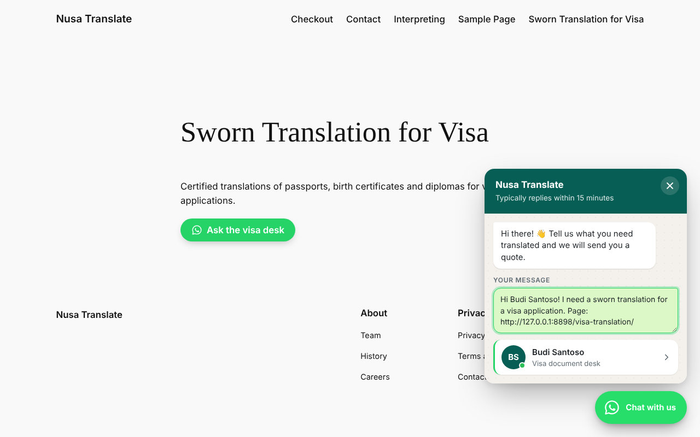
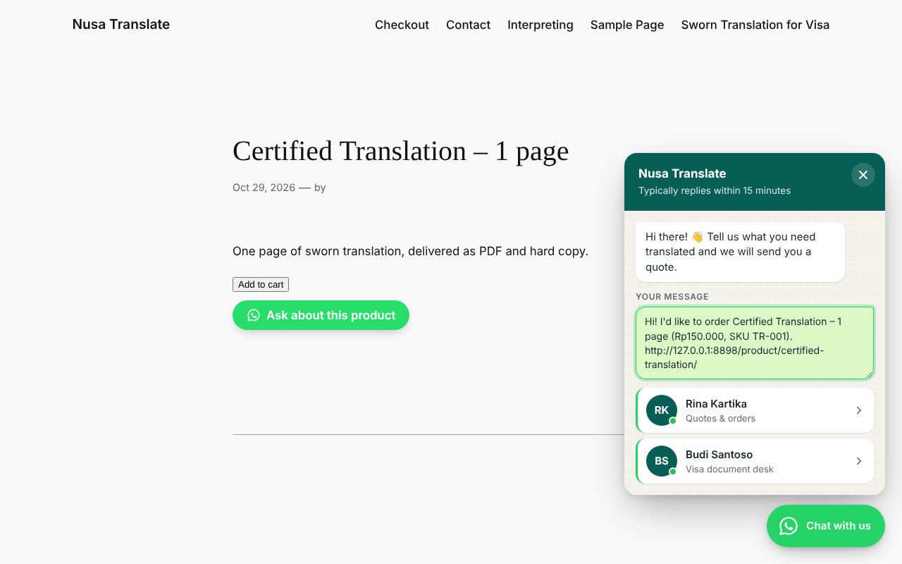
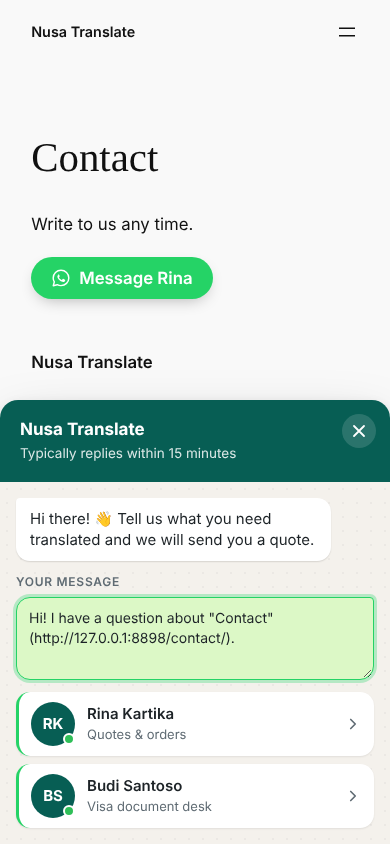
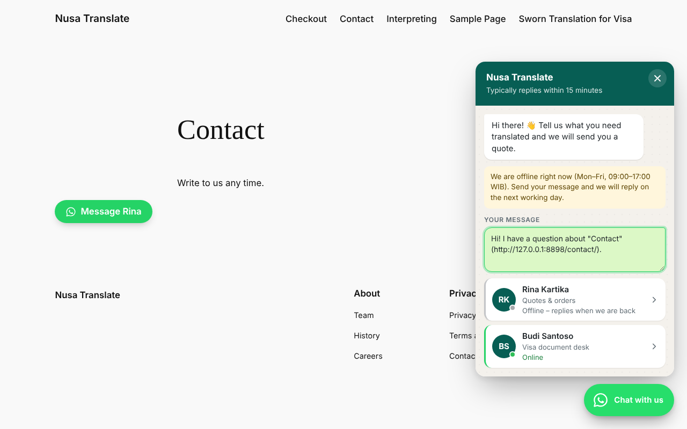
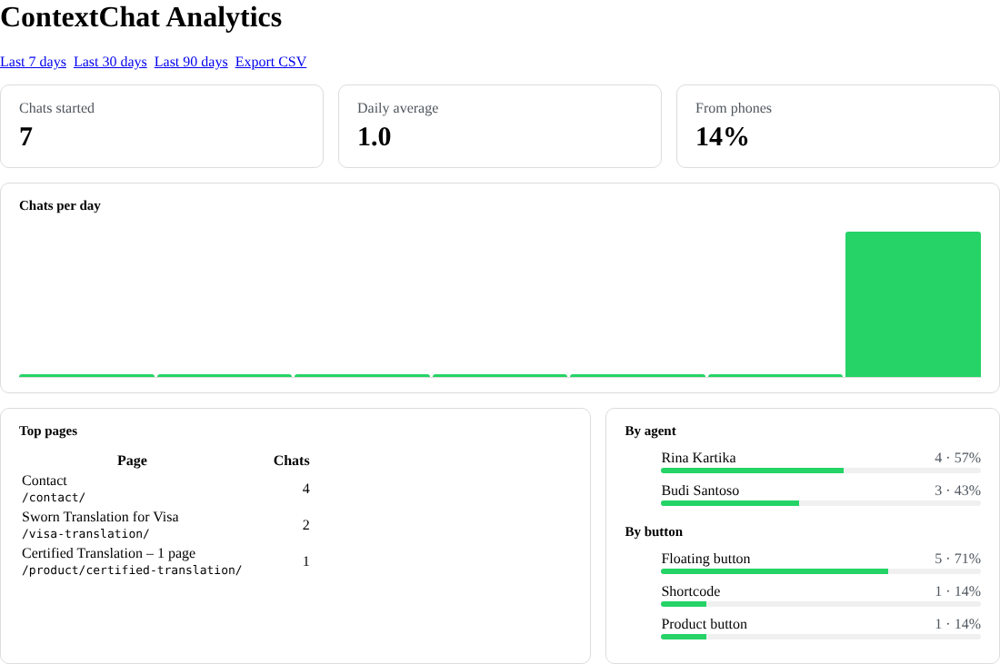

# ContextChat

A WordPress plugin that adds a chat button for WhatsApp. Unlike most chat buttons, it fills in the message with what the visitor was looking at — the page, the product and its price, the campaign they came from — and sends it to the right person on your team.

So the first message you receive reads *"Hi Budi! I need a sworn translation for a visa application. Page: example.com/visa-translation/"* instead of *"Hi"*.

| Visa page: rule routes to the visa desk | Product page | On a phone |
|---|---|---|
|  |  |  |

## What it does

- **Context in every message.** Templates with placeholders: `{page_title}`, `{page_url}`, `{product_name}`, `{product_price}`, `{product_sku}`, `{utm_source}`, `{referrer}`, `{agent_name}` and more. Empty values disappear cleanly, and `{name|fallback}` supplies a default.
- **Context rules.** Different message and agents by address, page, content type, post or product category, any product page, the home page or search results. First match wins. A page can also set its own message in the editor.
- **Agents.** Up to 20, each with photo, role and an "always available" switch.
- **Opening hours.** Weekly schedule in the site time zone, shifts past midnight, offline note, optional "(sent outside business hours)" line, or hide the button while closed.
- **The visitor sees and can edit the message** before WhatsApp opens. People trust what they can read.
- **WooCommerce** "Ask about this product" button with name, price, SKU and link.
- **Shortcode and block**: `[contextchat text="Chat with us" agent="rina"]` and a "ContextChat button" block.
- **Privacy-friendly analytics**: clicks by day, page, agent, button and device; CSV export; optional Google Analytics / Tag Manager events. No IP addresses, cookies or message text are stored.
- **Translated into Indonesian** (Bahasa Indonesia), including the block editor strings. The plugin follows the site language set under Settings → General.
- **Fast and accessible**: one small script with no jQuery, loaded only where a button shows; every button is a real link that works without JavaScript; keyboard and screen-reader support; reduced-motion and dark-mode aware; a bottom sheet on phones; works with page caching.

| Opening hours | Analytics |
|---|---|
|  |  |

## Install

```bash
npm run build
```

This writes `dist/contextchat-1.0.0.zip`. In WordPress go to **Plugins → Add New → Upload Plugin**, upload the zip and activate it. Then open **ContextChat** in the admin menu and enter your number (with country code) or add agents.

Requirements: WordPress 6.2 or newer, PHP 7.4 or newer. WooCommerce is optional.

## For developers

Filters:

| Filter | Use |
|---|---|
| `contextchat_context` | Add or change placeholder values. Any key you add works as `{key}`. |
| `contextchat_message` | Change the message template for a button. |
| `contextchat_agents` | Change which agents are offered on a page. |
| `contextchat_should_display` | Show or hide the floating button. |

In the browser, `document` receives a `contextchat:click` event with `{ agent, source, rule, path, post, device }` for every chat started.

How it fits together:

- `includes/class-template.php` – template rendering, phone numbers, links. Pure PHP.
- `includes/class-context.php` – what the visitor is looking at, which rule applies, which agents to offer.
- `includes/class-frontend.php` – floating button, panel, shortcode and block. Buttons are links built on the server; the script then adds what only the browser knows.
- `assets/js/contextchat.js` – the same template rules as the PHP, plus opening hours, the panel and click tracking.
- `includes/class-analytics.php` – click table, the public `POST /wp-json/contextchat/v1/click` endpoint (validated and rate limited), reports.
- `includes/class-admin.php`, `class-settings.php` – settings screen and strict sanitising of every saved value.

## Translations

`plugin/contextchat/languages/` holds the template (`contextchat.pot`) and the Indonesian translation (`contextchat-id_ID.po`). After changing strings in the code or editing a `.po` file, run:

```bash
npm run i18n
```

This refreshes the template and rebuilds the `.mo` file (PHP strings) and the `.json` file (block editor strings) for every language. To add a language, copy `contextchat.pot` to `contextchat-<locale>.po`, translate it, and run the same command.

## Tests

```bash
npm test           # PHP and JavaScript unit tests (no WordPress needed)
npm run test:e2e   # browser tests against a real WordPress site
```

The PHP and JavaScript template engines are checked against the same cases in `tests/fixtures/templates.json`, so the link built on the server and the one built in the browser always say the same thing.

The browser tests build a throwaway WordPress 6.5 site on SQLite (from the `@wp-playground/wordpress-builds` npm package, so neither MySQL nor wordpress.org is needed), start PHP's built-in server, and drive Chromium through: rule routing, the Indonesian translation, editing the message, campaign tags, hidden pages, the product button, phones, opening hours, direct mode, saving settings through the admin form, the analytics screen, endpoint validation and rate limiting, and finally a clean uninstall. Any PHP notice from the plugin fails the run.

Limits of the test setup, stated plainly:

- WooCommerce itself is not installed; `tests/e2e/fake-woocommerce.php` provides the few functions the plugin calls. Test against a real WooCommerce store before relying on the product button.
- The npm WordPress build leaves out many core admin scripts and styles, so drag-to-reorder (jQuery UI), the media-library avatar picker and the block in the editor are not exercised by the tests.
