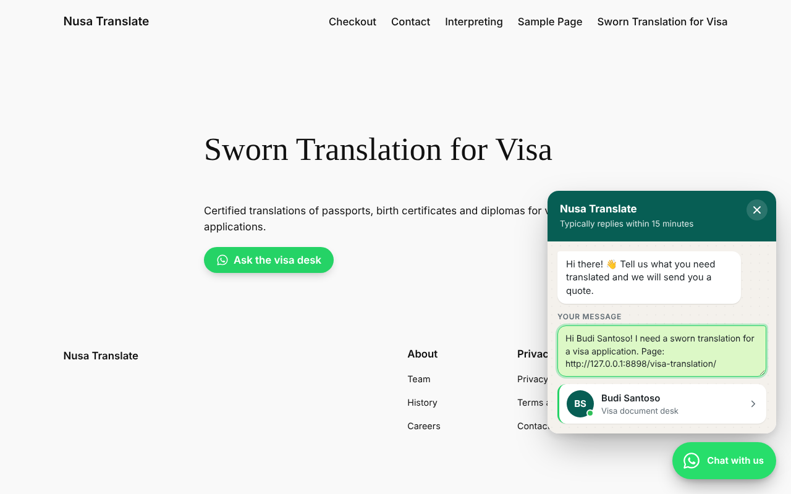
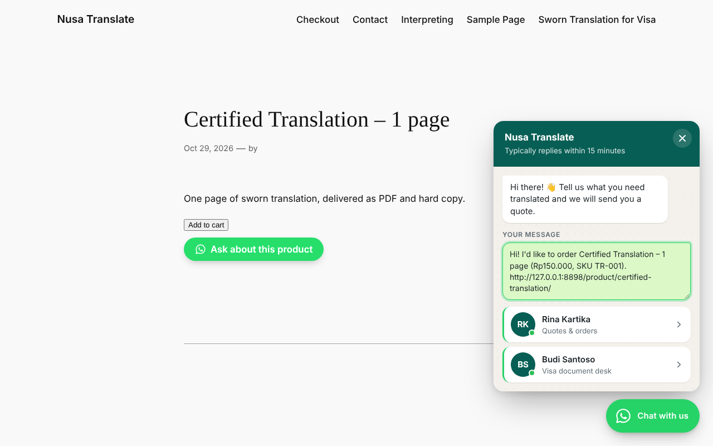
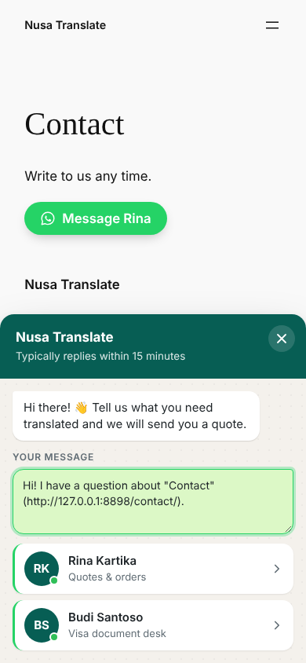
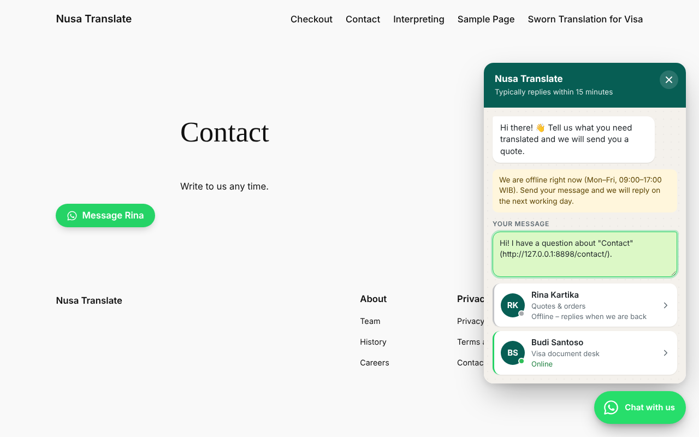
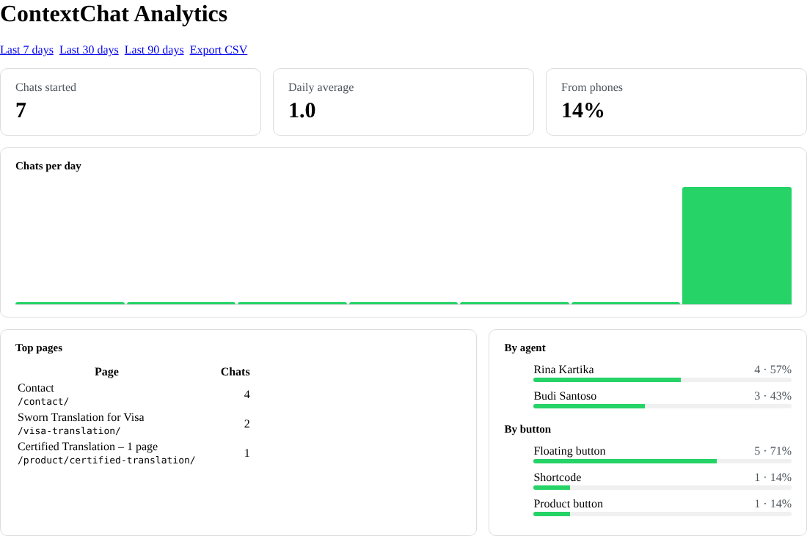

# ContextChat

A WordPress plugin that adds a chat button for WhatsApp. Unlike most chat buttons, it fills in the message with what the visitor was looking at — the page, the product and its price, the campaign they came from — and sends it to the right person on your team.

So the first message you receive reads *"Hi Budi! I need a sworn translation for a visa application. Page: example.com/visa-translation/"* instead of *"Hi"*.

| Visa page: rule routes to the visa desk | Product page | On a phone |
|---|---|---|
|  |  |  |

## What it does

- **Context in every message.** Templates with placeholders: `{page_title}`, `{page_url}`, `{product_name}`, `{product_price}`, `{product_sku}`, `{utm_source}`, `{referrer}`, `{agent_name}` and more. Empty values disappear cleanly, together with the brackets, quotes or comma around them, and `{name|fallback}` supplies a default. Everything else is sent exactly as written.
- **Context rules.** Different message and agents by address, page, content type, post or product category, any product page, the home page or search results. First match wins. A page can also set its own message in the editor.
- **Agents.** Up to 20, each with photo, role and an "always available" switch.
- **Opening hours.** Weekly schedule in the site time zone, shifts past midnight, offline note, optional "(sent outside business hours)" line, or hide the button while closed.
- **The visitor sees and can edit the message** before WhatsApp opens. People trust what they can read.
- **WooCommerce** "Ask about this product" button with name, price, SKU and link.
- **Shortcode and block**: `[contextchat text="Chat with us" agent="rina"]` and a "ContextChat button" block.
- **Privacy-friendly analytics**: clicks by day, page, agent, button and device; CSV export; optional Google Analytics / Tag Manager events. No IP addresses, cookies or message text are stored.
- **SI assistant (2.0, optional)**: a chat in the panel on Anthropic's Claude models, with the site's own key. It answers from your knowledge entries, gives estimates calculated in code from your price table, refuses ID numbers and documents, and hands over to your team on WhatsApp or by email with a summary. Off until you turn it on; see [SI assistant](#si-assistant-20).
- **Translated into Indonesian** (Bahasa Indonesia), including the block editor strings. The plugin follows the site language set under Settings → General.
- **Fast and accessible**: one small script with no jQuery, loaded only where a button shows; every button is a real link that works without JavaScript; keyboard and screen-reader support; reduced-motion and dark-mode aware; a bottom sheet on phones; works with page caching.

| Opening hours | Analytics |
|---|---|
|  |  |

## Install

The easiest way is to download the zip from the [ContextChat releases](https://github.com/ZenZeiTen/synthapps/releases?q=contextchat&expanded=true). Each release has a `contextchat-<version>.zip`, at an address of this form:

`https://github.com/ZenZeiTen/synthapps/releases/download/contextchat-v<version>/contextchat-<version>.zip`

To build the zip yourself you need [Node.js](https://nodejs.org/) 18 or newer and a copy of this repository. The build has no other dependencies, and works the same in PowerShell, Command Prompt, macOS and Linux. Run it from the `contextchat` folder of your copy:

```bash
cd synthapps/contextchat
```

```bash
npm run build
```

On Windows, if you don't know where your copy is, open the `contextchat` folder in File Explorer, type `powershell` in the address bar and press Enter: PowerShell opens in that folder. Running `npm run build` anywhere else fails with "Could not read package.json".

The build prints the full path of the zip it wrote, `dist/contextchat-2.0.0.zip`. In WordPress go to **Plugins → Add New → Upload Plugin**, upload the zip and activate it. Then open **ContextChat** in the admin menu and enter your number (with country code) or add agents.

Requirements: WordPress 6.2 or newer, PHP 7.4 or newer. WooCommerce is optional.

ContextChat is not on WordPress.org, so it opts out of WordPress.org updates (`Update URI: false`, and it drops any cached offer). A WordPress.org plugin in a folder of the same name can never replace it. To update, upload a newer zip and choose **Replace current with uploaded**.

## Releasing

1. Update `RELEASE_NOTES.md` and the `Version:` line in `contextchat.php`, and merge to `main`.
2. On GitHub, open **Actions → ContextChat plugin → Run workflow**, keep the branch on `main`, tick **Publish a release**, and click **Run workflow**.

The run tests everything, builds the zip, and publishes the release `contextchat-v<version>` with `RELEASE_NOTES.md` as its description, creating the tag on the tested commit. The run's summary links to the release. A version with a suffix, such as `2.0.0-dev`, is published as a pre-release, so it is never shown as the repository's latest release.

Pushing a tag yourself works too (`git tag contextchat-v1.1.0 && git push origin contextchat-v1.1.0`); the workflow refuses a tag that does not match the `Version:` line. If a release with that tag already exists, even as a draft, the zip is added to it and a draft is published.

## For developers

Filters:

| Filter | Use |
|---|---|
| `contextchat_context` | Add or change placeholder values. Any key you add works as `{key}`. |
| `contextchat_message` | Change the message template for a button. |
| `contextchat_agents` | Change which agents are offered on a page. |
| `contextchat_should_display` | Show or hide the floating button. |
| `contextchat_si_prices` | Model prices (US dollars per million tokens) used for the SI daily spending cap. Add a model, or correct a price that changed. |
| `contextchat_si_api_url` | The Claude Messages API endpoint. Used by the tests to point at a mock server. |
| `contextchat_client_ip` | The visitor address used to rate limit click counting. Needed only behind a proxy or CDN that does not pass the visitor's address on as `REMOTE_ADDR`; without it all visitors share one limit of 20 clicks a minute. |

In the browser, `document` receives a `contextchat:click` event with `{ agent, source, rule, path, post, device }` for every chat started.

How it fits together:

- `includes/class-template.php` – template rendering, phone numbers, links. Pure PHP.
- `includes/class-context.php` – what the visitor is looking at, which rule applies, which agents to offer.
- `includes/class-frontend.php` – floating button, panel, shortcode and block. Buttons are links built on the server; the script then adds what only the browser knows.
- `assets/js/contextchat.js` – the same template rules as the PHP, plus opening hours, the panel and click tracking.
- `includes/class-analytics.php` – click table, the public `POST /wp-json/contextchat/v1/click` endpoint (validated and rate limited), reports. Clicks are stored in UTC and reported by day in the site time zone.
- `includes/class-admin.php`, `class-settings.php` – settings screen and strict sanitising of every saved value.
- `includes/class-admin-analytics.php` – the analytics screen and CSV export.

## SI assistant (2.0)

ContextChat 2.0 adds an SI (Synthesized Intelligence) assistant to the chat panel, following the ContextChat 2.0 design plan (kept outside this repository). This first part adds the **ContextChat → SI** settings tab:

- **API key.** Put it in `wp-config.php` as `define( 'CONTEXTCHAT_ANTHROPIC_KEY', 'sk-ant-…' );`, or paste it into the tab. A pasted key is stored encrypted (libsodium secretbox, with a key derived from `AUTH_KEY`), in its own option that is not autoloaded. It is never shown again, sent to the browser or logged. If `AUTH_KEY` changes, the key can no longer be read and the tab asks for it again.
- **Model routing.** In automatic mode Claude Haiku 5.5 writes every reply and Claude Sonnet 5.5 writes it again only when the reply fails a check, is declined (`stop_reason: refusal`) or is cut off before any text, or when the fast model's ID does not exist. A wrong key, an invalid request and the Anthropic account's spend limit stop at once; a busy API (429, 5xx, timeouts) is retried once on the same model. Two other modes: fast model only, and stronger model for every reply. Both model IDs can be changed. Requests to Sonnet, Opus and Fable models ask for Anthropic's server-side refusal fallbacks.
- **Daily spending cap.** Each response's `usage` is priced (`includes/si/class-si-pricing.php`) and added to today's total in the site time zone. At the cap, nothing more is sent until the next day. Default: USD 10.
- **Test connection.** Sends one message with the saved settings and shows which model answered, the tokens and the cost. A checkbox treats the first reply as failing a check, to show the stronger model taking over.

Requests use `anthropic-version: 2026-10-21` and `output_config.effort` (default `low`, enough for chat). `max_tokens` defaults to 1,024 rather than the plan's 400, because Haiku 5.5 thinks by default and thinking counts toward `max_tokens`. The code is in `includes/si/`: `class-si-router.php` (routing, pure PHP), `class-si-client.php` (the HTTP call), `class-si-secrets.php` (the key), `class-si-pricing.php` and `class-si.php` (settings, spend meter, the test endpoint `POST /wp-json/contextchat/v1/admin/si-test`, administrators only).

The second part adds what the chat will quote from. None of it is shown to visitors yet:

- **Price engine** (`includes/si/class-price-engine.php`, pure PHP). It is the only place a translation price is calculated: whole rupiah as integers, the express surcharge and volume discount applied together with one round-half-up step, the discount on the translation fee only, never on legalisation, and a 50% deposit from Rp 1.000.000. It returns `ok`, `unavailable` (the pair or package is not offered) or `needs_team` (express, corporate work over 40 documents, or a destination country it cannot place), with the lines, totals and an `EST-YYYYMMDD-XXXX` reference. `assets/js/price-engine.js` is a browser copy, and both run the vectors in `tests/fixtures/prices.json`.
- **Price table** (`data/price-table.nusalexia.json`), taken from https://www.nusalexia.co.id/daftar-harga/ on 21 November 2026.
- **Legalisation route** (`includes/si/class-countries.php`). Apostille for a party to the Apostille Convention, ministry plus embassy legalisation otherwise, none for Indonesia. The parties come only from `data/apostille-members.json`, built from the official HCCH status table (https://www.hcch.net/en/instruments/conventions/status-table/?cid=41) and its territorial extensions on 21 November 2026, with each party's entry-into-force date. No objection notice names Indonesia, and none was raised against Indonesia's accession, so the Convention applies between Indonesia and every listed party. Review the list at least once a year. Country names in English and Indonesian (`data/countries.json`) come from the Unicode CLDR data in PHP's `intl`, plus common spellings such as "UEA", "Korsel" and "Holland".
- **Tables** for conversations, messages, quotes and events (`includes/class-installer.php`), created on activation and whenever the schema version (`contextchat_si_db_version`) changes. Deleting the plugin removes them.

The third part adds the checks on both sides of the model:

- **Guard** (`includes/si/class-guard.php`). Every visitor message is checked before the model sees it. A message is blocked, and neither sent nor stored, when it:
  - is over 1,000 characters;
  - is only markup (other markup is stripped and the message flagged);
  - contains a `data:` URI or a base64-looking run of 200+ characters;
  - links to a file (`.pdf`, `.docx`, `.jpg` and so on) or a file-sharing host (Google Drive, Dropbox, WeTransfer and others);
  - contains a 16-digit NIK, a passport-like number, or a 13–19 digit card number that passes the Luhn check.

  Amounts such as "Rp 1.775.000", phone numbers and dates pass. Rate limits default to 8 messages a minute and 80 a day per visitor, 6 new conversations an hour, and 40 messages per conversation. They count per visitor address hashed with HMAC-SHA256 and a secret that changes every day; the address itself is never stored.
- **Reply checker** (`includes/si/class-validator.php`). Every SI reply is checked before the visitor sees it. A reply is rejected when it:
  - names a rupiah amount that is not in the latest quote or the published rates, in any spelling ("Rp 1.775.000", "Rp1,775,000", "Rp 125 rb", "Rp 1,5 jt", "1.775.000 rupiah");
  - names someone on the staff-name list;
  - is longer than 5 sentences or about 90 words without a quote card;
  - uses "AI", "kecerdasan buatan", slang such as "gak" or "nggak", or emoji;
  - makes a promise ("pasti diterima", "dijamin", a promised discount).

  Links other than wa.me, the site's own domain and the team's email address are removed.

Test cases: `tests/fixtures/guard.json` and `tests/fixtures/validator.json`.

The fourth part adds what the SI knows and how it writes, with two new tabs:

- **Knowledge** (`includes/si/class-knowledge.php`, tab **Knowledge**/**Pengetahuan**). 26 entries in `data/knowledge.nusalexia.json`, taken on 21 November 2026 from:
  - the Nusalexia admin guidelines in Notion (services, delivery, revisions, express rules, accepted formats, FAQ, escalation);
  - nusalexia.co.id: how to order, the price page's payment and discount notes, and the six document pages.

  Left out on purpose: the NPWP, bank account number, staff names, client list and internal procedures. The entries are about 3,600 tokens, so all of them go to the model with each request. A keyword search (`search()`) backs the `lookup_knowledge` tool. In the tab you can edit, add and remove entries, export and import JSON, and restore the bundle. Until you change the entries, the bundled ones are used and follow plugin updates.
- **Voice** (`includes/si/class-voice.php`, tab **Voice**/**Gaya bahasa**). `data/voice.nusalexia.json` holds:
  - the voice guide from the design plan, in Indonesian and English;
  - 10 example replies, the first being the owner's sample word for word;
  - 16 fixed replies in both languages (greeting, privacy notice, busy, rate limit, blocked file or ID, staff-name question and others);
  - extra banned words, and the list of names the reply checker blocks.

  That list ships empty, so no staff name is published in the plugin; add names in the tab. Every fixed reply and example passes the reply checker (unit-tested).

Both are stored in options that are not autoloaded.

The fifth part adds the conversation itself, on the server:

- **Orchestrator** (`includes/si/class-orchestrator.php`). Each visitor turn:
  - sends the model a cached instruction block (`includes/si/class-prompt.php`: role and limits, the no-name rule, voice and examples, intake and asking rules, handoff rules, the price table's rates and the knowledge entries) and a separate line with the conversation state, plus the last 20 messages;
  - lets the model use four tools: `record_intake` (keeps only the intake fields of the design plan, cleaned), `get_quote` (the price engine), `lookup_knowledge` and `request_handoff`, for up to 3 tool rounds;
  - checks the reply with the reply checker, retries once on the stronger model with the reason, and otherwise sends a fixed reply with the handoff card.

  Requests for the instructions or for a person's name get a fixed reply without calling the model. The handoff card is offered when:
  - the model asks for it;
  - a quote needs the team (express, large corporate) or the pair is not offered;
  - an interpreting intake is complete;
  - the visitor asks for WhatsApp, email or a person, or hesitates about the price (keyword backup);
  - the API fails, the daily cap is reached, or after 40 visitor messages.
- **Handoff** (`includes/si/class-handoff.php`). The summary is in the design plan's format, in Indonesian or English, and kept under 1,000 characters for WhatsApp by dropping the least important lines first. The email subject follows the house format `[Nusalexia] Terjemahan Tersumpah - EST-… - Permintaan Penawaran`. The summary goes to the agent chosen for translation or interpreting, else the first available agent, and the email to the address set on the SI tab.
- **Endpoints** (`includes/si/class-chat-rest.php`): `POST chat/start`, `chat/message`, `chat/handoff`, `chat/idle` and `chat/resume` under `/wp-json/contextchat/v1/`, all POST so tokens never appear in addresses, with `Cache-Control: no-store`.
  - **Access:** each conversation has a random token, given once and stored only as a SHA-256 hash. Requests from other sites (a foreign `Origin`) and bodies over 4 KB are refused.
  - **Order of checks:** the rate limits, the 1.5-second first-message check and the guard all run before the model. Blocked messages are not stored.
  - **When it answers:** only when the SI chat is turned on (SI tab, off after updating) and a key is saved.
- **Data** goes into the conversations, messages, quotes and events tables, with tokens and cost per conversation.
- **New filters:** `contextchat_si_enabled`, `contextchat_si_reply`, `contextchat_price_table`, `contextchat_handoff_text`, `contextchat_si_limits`, `contextchat_si_file_hosts`.

The sixth part puts the chat in the panel (`assets/js/chat.js`).

When the SI chat is on, opening the panel loads the chat script, the first time only (about 5 KB gzipped). The chat then takes over the panel body:

- the greeting (and a notice above it, if one is set on the Voice tab; none by default);
- a message box with a 1,000-character counter (Enter sends, Shift+Enter starts a new line) and a typing indicator;
- the **quote card**: lines, express surcharge, discount, total, 50% deposit, reference, "estimate" note and 7-day validity;
- the **handoff card**: the summary the visitor can edit, then WhatsApp and Email buttons, the agent's label, and the hours note when you're offline.

How it behaves:

- After a quote, the team is offered once if the visitor stays silent for the set minutes; typing resets the timer.
- Pasted or dropped files are refused in the browser.
- The conversation resumes after a reload in the same tab (`sessionStorage`, no cookies).
- Everything from the server is written as text, never as HTML.

If the chat can't start, for example because it was switched off while the page was open, the 1.1 panel comes back. Without JavaScript, the button is still the 1.1 WhatsApp link. On phones the chat fills the bottom sheet. Dark mode, reduced motion, keyboard use and screen readers are supported: the conversation is a live region, and each message says who wrote it.

**To try it:**

1. On the SI tab, save your key and press **Test connection**.
2. Add staff names under **Voice**.
3. Choose the agents and the email for handoffs.
4. Tick **Turn on the SI chat**.

The seventh part adds the admin screens:

- **Prices** tab (`includes/si/class-prices.php`). Edit the price table:
  - rates per language pair, regular and sworn;
  - legalisation and terminology fees;
  - the next-day and same-day surcharges;
  - two volume-discount tiers;
  - the deposit rule, minimum pages, revisions and how long estimates stay valid.

  Also: JSON import and export, a way back to the bundled table, and a warning after 90 days without a check. The Apostille member list is edited as lines (`AU 1995-03-16 Australia`), with a warning after a year. Both are stored only when they differ from the bundled data, so plugin updates keep bringing newer bundled prices until you change them.
- **Privacy** tab:
  - the keep-for period (30–3650 days, default 365), which sets the expiry of new chats and the daily clean-up;
  - the privacy policy address, shown with the "Agree and start" button;
  - the rate limits;
  - the refused file-sharing hosts.

  `{retention}` in the notice shows the period.
- **ContextChat → Conversations** (`includes/si/class-admin-conversations.php`), administrators only:
  - a list with filters and search by reference;
  - the transcript, with the team summary, estimates and processing record;
  - a JSON export (without the token hash), for a visitor who asks for a copy;
  - delete with a confirm box, recorded by reference only. Export and delete each check a nonce.

The eighth part is the privacy check. [`docs/privacy-draft.md`](docs/privacy-draft.md) goes through Indonesia's Personal Data Protection Law (UU 27/2022) and its implementing regulation (PP 33/2026, in force from 16 January 2027), read from official copies. For each requirement it gives the article, what the plugin does, and what needs a legal decision; the transfer of chat text to Anthropic outside Indonesia comes first. Following it:

- the chat window shows only the business name. There is no notice by default and no mention of SI or Anthropic, at the owner's request. The model introduces itself only as the business, never claims to be a person, and says the chat is answered automatically when asked. Where the transfer is described, and what that means for PP 33/2026 Pasal 164, is in the doc;
- the Conversations screen finds a chat by the estimate reference (EST-…) a visitor received, as well as by its own reference;
- an option, **Ask visitors to agree first**, shows a button before the chat and records the click with a fingerprint of what was shown. The button reads **Agree and start** when a notice is set, and **Start chatting** / **Mulai ngobrol** otherwise; the notice and policy link appear beside it when set;
- WordPress's **Settings → Privacy → Policy Guide** offers a suggested policy section, with the site's settings filled in and placeholders for the legal review (`includes/si/class-privacy.php`).

It is a starting point, not legal advice.

The ninth part is a set of 30 golden conversations (`tests/golden/`), in Indonesian and English, covering:

- estimates across language pairs and legalisation routes, express jobs and volume discounts, and a pair that is not offered;
- interpreting, knowledge questions, price hesitation and asking for a person;
- prompt injection, staff names, ID numbers and file links;
- an off-topic question, a request for a promise, and a three-turn intake.

`npm test` runs them dry: it checks the file, works out every expected estimate with the price engine, and plays the turns that are answered without the model. `npm run eval` plays them against the real API with the bundled knowledge, voice and prices, checks each reply (estimate, handoff, language, wording), and has Claude Haiku grade the tone against the voice guide. It needs `ANTHROPIC_API_KEY`, stops at `--max-cost` (default USD 2), writes `tests/golden/results/<time>/report.md`, and never runs in CI. Run it after changing the prompt, the voice, the knowledge or the models.

The tenth part adds **SI analytics** under ContextChat → Analytics (`includes/si/class-si-analytics.php`):

- the funnel: chats started, chats where the visitor wrote, estimates given, team offered, went to the team (by WhatsApp or email);
- the service asked for;
- refusals and errors (ID numbers, file links, rate limits, replies rewritten by the checker, API errors, the spending cap);
- the model cost in total and per chat.

A CSV export gives one row per chat, without message text: reference, language, device, path, status, service, handoff, number of visitor messages and estimates, last estimate and cost. Only chats still kept are counted.

## Translations

`plugin/contextchat/languages/` holds the template (`contextchat.pot`) and the Indonesian translation (`contextchat-id_ID.po`). After changing strings in the code or editing a `.po` file, run:

```bash
npm run i18n
```

This refreshes the template, brings every `.po` file in line with it (new strings are added empty and listed as "to translate", removed ones are dropped, translations are kept), and rebuilds the `.mo` file (PHP strings) and the `.json` file (block editor strings) for every language. To add a language, copy `contextchat.pot` to `contextchat-<locale>.po`, translate it, and run the same command.

## Tests

```bash
npm test           # PHP and JavaScript unit tests, and the golden conversations dry run (no WordPress needed)
npm run test:e2e   # browser tests against a real WordPress site
npm run eval       # golden conversations against the real API (needs ANTHROPIC_API_KEY; costs money)
```

The PHP and JavaScript template engines are checked against the same cases in `tests/fixtures/templates.json`, so the link built on the server and the one built in the browser always say the same thing. The two price engines share `tests/fixtures/prices.json` in the same way.

The browser tests build a throwaway WordPress 6.5 site on SQLite (from the `@wp-playground/wordpress-builds` npm package, so neither MySQL nor wordpress.org is needed), start PHP's built-in server, and drive Chromium through: rule routing, the Indonesian translation, editing the message, campaign tags, hidden pages, the product button, phones, opening hours, a delayed button with and without JavaScript, direct mode, saving settings through the admin form, the settings tabs and repeaters, the analytics screen and its time zone handling, endpoint validation and rate limiting, a cached WordPress.org update offer for the `contextchat` folder (which must show as `none` in `wp plugin list`), and finally a clean uninstall. Any PHP notice from the plugin fails the run. The update-offer check needs WP-CLI: set `WP_CLI` (for example `WP_CLI="php wp-cli.phar"`) or have `wp` on your PATH; without it the check is skipped. CI always runs it.

Limits of the test setup, stated plainly:

- WooCommerce itself is not installed; `tests/e2e/fake-woocommerce.php` provides the few functions the plugin calls. Test against a real WooCommerce store before relying on the product button.
- The npm WordPress build leaves out many core admin scripts and styles, so drag-to-reorder (jQuery UI), the media-library avatar picker and the block in the editor are not exercised by the tests.
- The test site uses SQLite through WordPress's SQLite integration, not MySQL or MariaDB, and is a single site, not a network (multisite).
