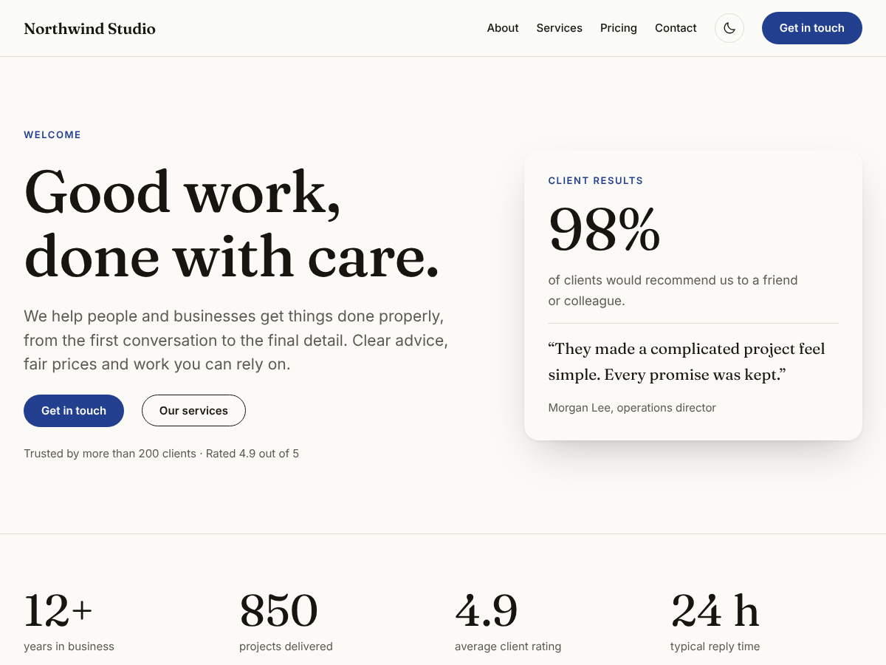

# Corbelwise

A WordPress block theme for any business, plus an optional companion plugin with switchable modules and an AI assistant powered by Claude. Built for commercial release: GPL-licensed, translation-ready, tested on a real WordPress, and updated by uploading a zip (never through WordPress.org, so no other product can replace it).



| Folder | What it is |
|---|---|
| [`theme/corbelwise`](theme/corbelwise) | The block theme (Full Site Editing) |
| [`plugin/corbelwise-toolkit`](plugin/corbelwise-toolkit) | The Corbelwise Toolkit plugin: performance, security, SEO and schema, business details, announcement bar, AI assistant |
| [`docs/USER-GUIDE.md`](docs/USER-GUIDE.md) | Plain-language guide for buyers: install, set up, modules, AI setup, costs and privacy |
| [`tests`](tests) | Static checks, block validation, integration and browser tests, and the CI smoke test |
| [`scripts`](scripts) | Release zips and translation templates |

The features that marketplaces treat as "plugin territory" (SEO, security, AI, shortcodes) live in the plugin, so the theme passes marketplace review on its own and the site owner keeps their settings when they change theme.

## The theme

- **Six style variations** for different kinds of business: Ink (default), Ocean, Sage, Ember, Noir and Mono. Each defines a light palette, a dark palette and fonts. Every text colour pair meets WCAG AA contrast (4.5:1) in both modes; a test checks all 84 pairs.
- **36 patterns**: 21 sections (heroes, services, features, numbers, steps, story, team, contact, testimonials, pricing, questions, calls to action, latest posts), 5 full pages (home, about, services, pricing, contact) offered when a page is created, and the hidden patterns behind the templates, which keep every string translatable.
- **Templates**: index, blog home, single post, page, archive, search, 404, and four custom templates (page without title, wide page, landing page, blank canvas). Template parts for a full and a minimal header and footer.
- **Light and dark mode** without a flash: the palette swap is pure CSS keyed on `data-color-scheme` on `<html>`, which PHP prints, so following the device needs no JavaScript. With the switch enabled, under 200 bytes of inline script apply a saved choice before the first paint. The switch is a server-rendered block (`corbelwise/color-scheme-toggle`) with a 1.4 KB deferred script, loaded only on pages that show it.
- **Fast**: no jQuery; theme CSS is 12 KB (3 KB gzipped) and inlined by WordPress, so it costs no request; Inter and Fraunces are self-hosted variable fonts split by Unicode range, and only the Latin upright files the active style uses are preloaded. Core block styles load per block.
- **Block styles**: card, raised card, eyebrow, lead paragraph, checklist, image shadow, arrow link, FAQ.
- **Appearance → Corbelwise**: getting-started steps, dark mode and sticky header options, and one click to create five starter pages and set the front page (existing pages at those addresses are never touched).

## The Corbelwise Toolkit plugin

Six modules, each switched on or off under the **Corbelwise** menu. A module that is off registers nothing on public pages.

| Module | Default | What it does |
|---|---|---|
| Performance | On | Removes the emoji script and styles, unused header links and (optionally) embed discovery; keeps the heartbeat off public pages; limits revisions; stops self-pings; optional jQuery Migrate removal |
| Security | On | `X-Content-Type-Options`, `X-Frame-Options`, `Referrer-Policy`, `Permissions-Policy` headers; optional HSTS; login pause after repeated failures per address (stored as a salted hash, never the IP); one message for wrong username or password; usernames hidden from the REST API, `?author=` scans, sitemaps and oEmbed; optional XML-RPC and file-editor switches |
| SEO and sharing | On | Search description field in the editor; meta description, Open Graph and X cards; JSON-LD graph (business, website with search action, web page, breadcrumbs, blog posting); `noindex` for search and 404. Steps aside when Yoast SEO, Rank Math, All in One SEO, SEOPress, The SEO Framework or Slim SEO is active |
| Business details | On | Name, type, address, phone, email, hours, price range and social profiles, used by shortcodes, the structured data and the AI prompts |
| Announcement bar | Off | Message with optional button, colours, dismissal remembered per message, start and end dates |
| AI assistant | Off | Writing assistant in the editor and an optional visitor chat; see below |

### The AI assistant

- **Writing assistant**: a sidebar in the post editor (no build step) that drafts from a brief, rewrites selected blocks (clearer, shorter, longer, grammar, friendlier, more formal), and writes excerpts, search descriptions and title ideas. Results are previews; the post changes only when the author applies them. Output is filtered to a small set of HTML tags on the server before the editor converts it to blocks.
- **Visitor chat**: grounded in the business details, the owner's instructions and the site's own published content (the current page plus keyword search across public post types). Plain-text answers; web addresses become links; no HTML from the server is ever inserted as HTML.
- **Claude API**: requests go to the Messages API (`anthropic-version: 2026-10-21`) through WordPress's HTTP API. The Anthropic PHP SDK is not bundled because it needs PHP 8.1 and Composer dependencies that clash with other plugins on shared WordPress installs. Models offered: Claude Opus 5.5 (default), Claude Sonnet 5.5 and Claude Haiku 5.5. The chat runs at `low` effort, the writing assistant at `medium`. Opus 5.5 and Sonnet 5.5 requests opt into server-side refusal fallbacks (`"fallbacks": "default"`); a refusal or an empty reply is reported, never shown as an answer; thinking blocks are ignored.
- **Abuse and cost protection for the public endpoint**: the chat must work on cached pages, so instead of nonces each page carries an HMAC-signed timestamp valid for two days. The endpoint also rejects foreign `Origin` headers, malformed or oversized conversations (12 turns, 600 characters per visitor message, alternating roles), and enforces a per-visitor hourly limit and a site-wide daily cap. Provider error details are shown to editors only.
- **Keys**: stored encrypted (libsodium `secretbox`, key derived from the site's `AUTH` salt), never printed back, or read from `CWTK_ANTHROPIC_API_KEY` in `wp-config.php`.
- **Privacy**: conversations are not stored; suggested privacy-policy text is registered with WordPress.

## Developer notes

| Hook | Use |
|---|---|
| `cwtk_modules` (filter) | Add a module: return an instance of a `\Corbelwise\Toolkit\Module` subclass keyed by its id. It gets a settings tab automatically from `fields()` |
| `cwtk_ai_provider` (filter) | Swap the AI provider for any object implementing `\Corbelwise\Toolkit\Provider` |
| `cwtk_ai_models` (filter) | Change the model list on the settings screen |
| `cwtk_ai_chat_context` (filter) | Add knowledge-base text to what the chat reads |
| `cwtk_ai_error` (action) | Log AI failures, including the API's error detail |
| `cwtk_client_ip` (filter) | Return the real visitor IP behind a proxy or CDN (only trust the proxy's header when the request came from the proxy) |
| `cwtk_security_headers` (filter) | Add or change headers, for example a Content-Security-Policy |
| `cwtk_schema_graph` (filter) | Change the JSON-LD graph |
| `cwtk_seo_competing_plugin` (filter) | Make the SEO module step aside for another plugin |
| `cwtk_capability` (filter) | Let a role other than administrators manage the toolkit |
| `corbelwise_option` (filter) | Override a theme option from a child theme |
| `corbelwise_allow_wporg_updates` (filter) | Let WordPress.org update offers through for the theme folder |

Prefixes: theme functions `corbelwise_`, CSS `corbelwise-`; plugin namespace `Corbelwise\Toolkit`, options and transients `cwtk_`, REST namespace `cwtk/v1`, CSS `cwtk-`.

## Tests

```bash
npm ci
```

```bash
npm test
```

`npm test` runs, in order:

1. **Static checks** (`tests/static/run.php`, no WordPress): valid tokens in all variations, WCAG contrast of every text pair in light and dark mode, pattern headers and categories, references between templates, parts and patterns, balanced block comments, no hard-coded colours in patterns, text domains, direct-access guards, version numbers in every place they appear, and size budgets.
2. **WordPress tests** (`tests/run-wordpress-tests.sh`) on a throwaway WordPress 6.5 with SQLite (from the `@wp-playground/wordpress-builds` npm package, with core block styles restored from `@wordpress/block-library` 8.33.0):
   - **Block validation**: every block in every pattern, template and part is parsed with the WordPress 6.5 block library, exactly as the editor would, and must be valid.
   - **Browser** (Playwright): every page at desktop and phone width without sideways scroll, with one `h1` and one `main`; axe-core finds no serious or critical accessibility problems in light or dark mode; dark mode follows the device, the switch and a saved choice; the announcement bar closes and stays closed; the chat answers, links pages, closes with Escape, keeps focus right and survives navigation; every admin tab renders and saves through the Settings API, and a saved API key is never printed back.
   - **Integration** (`tests/wordpress/run.php`, 23 tests inside WordPress): settings sanitizing and tab merging, key encryption, login pause and messages, headers, hidden usernames, shortcodes, structured data, announcement dates, page tokens, rate limits and the daily cap, the Claude request shape and response parsing, prompt building and output cleaning, site search for the chat, both REST endpoints end to end, the starter-pages action, update-offer filtering and uninstall. Claude is replaced by a fake API (`tests/e2e/fake-anthropic.php`), so no key or network is needed.
3. **In CI only**, `tests/wordpress-smoke.sh` installs the current WordPress release with MySQL on PHP 7.4 and 8.3, creates the starter pages through the real admin form, loads every public page and admin screen, checks that WordPress.org offers no update for either folder, and validates every pattern and template inside that WordPress version's block editor.

## Release

```bash
scripts/build-zips.sh
```

builds `dist/corbelwise-<version>.zip`, `dist/corbelwise-toolkit-<version>.zip` and a marketplace package with both zips, the user guide and the license. In GitHub, the **Run workflow** button of the "Corbelwise" workflow with **Publish a release** ticked (on `main`), or a pushed `corbelwise-v<version>` tag, tests, builds and publishes a release.

When bumping a version, change it together in: `style.css` and `readme.txt` (`Stable tag`) and `CORBELWISE_VERSION` for the theme; the plugin header, `CWTK_VERSION` and `readme.txt` for the plugin; then run `python3 scripts/make-pot.py`. The static checks fail if the numbers disagree, and CI fails if the translation templates are stale.

## Licence

GPL-2.0-or-later (see [`LICENSE.txt`](LICENSE.txt)), as WordPress requires for themes and plugins. The bundled Inter and Fraunces fonts are under the SIL Open Font License 1.1.
