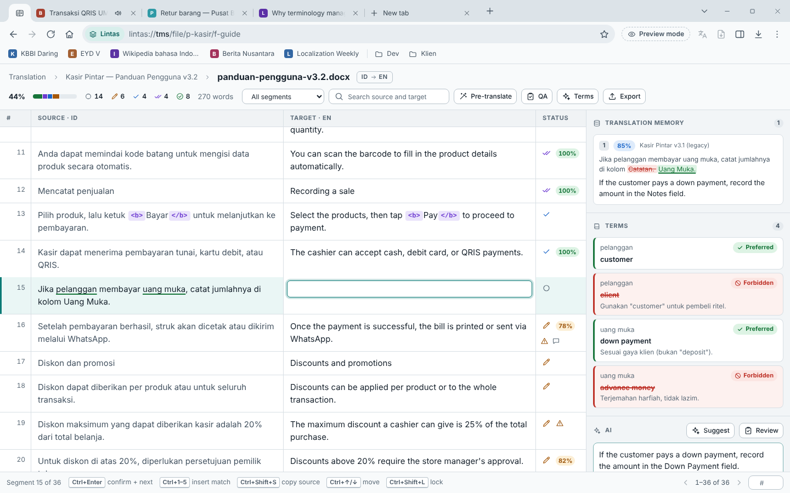

# Lintas

A fast, secure desktop web browser (Chromium engine) that works online and
offline, with a built-in **Translation Management System** and AI features
powered by Claude. Built for translators, localizers and linguists who also
write code.



## Features

**Browser**
- Chromium engine (Electron 45), every tab sandboxed, lazy session restore, private tabs.
- Tracker blocking, HTTPS-first with an optional HTTPS-only mode, third-party cookie
  stripping, Do Not Track and Global Privacy Control, per-site permission prompts.
- Tab strip, omnibox with suggestions, bookmarks bar, side panel, find in page, zoom,
  downloads, history and the usual keyboard shortcuts.

**Chrome extensions**
- Install from the Chrome Web Store: open chromewebstore.google.com in Lintas and choose
  *Add to Chrome*, or paste a store link on `lintas://extensions`. Installed extensions
  update automatically.
- Load unpacked extensions from a folder, for extension developers.
- Extension buttons and popups appear next to the address bar. Content scripts, background
  service workers, options pages and these `chrome.*` APIs work: `action`, `commands`,
  `contextMenus`, `cookies`, `notifications`, `runtime`, `storage`, `tabs`,
  `webNavigation`, `windows`, `webRequest`, `scripting`, `i18n`, `management` and
  devtools panels. This comes from Electron and
  [electron-chrome-extensions](https://github.com/samuelmaddock/electron-browser-shell).
- Lintas adds these on top, in extension pages and background workers, with the
  extension's manifest permissions checked on every call:
  `identity.launchWebAuthFlow` and `identity.getRedirectURL` (sign-in through a provider's
  web page), `tabs.captureVisibleTab`, `pageCapture.saveAsMHTML` and `userScripts`.
- Background workers only get these APIs when Lintas runs with Chromium's sandbox, which is
  the normal case. Started with `--no-sandbox` (needed as root), Electron skips the scripts
  that add them ([electron/electron#54322](https://github.com/electron/electron/issues/54322)),
  and `lintas://extensions` shows a warning.
- Extensions run in normal tabs, never in private ones.
- Not every Chrome extension works. Lintas is not Google Chrome, so extensions that need
  APIs Electron lacks fail or run in part. Examples: `identity.getAuthToken` (Google
  account sign-in), `sidePanel`, `offscreen`, `declarativeNetRequest` rule sets, and Manifest V2 features
  Chrome itself has removed. Password managers that need native messaging also
  will not work.

**Smartling Context Capture**
- Tested with Smartling Context Capture 5.1.2 loaded in Lintas: it installs, its toolbar
  button opens the capture panel on the page, its background worker extracts the page, and
  the screenshot, MHTML capture and sign-in redirect APIs it calls all work.
- Not tested: signing in to Smartling and uploading a capture, because that needs a
  Smartling account. Sign-in uses `identity.launchWebAuthFlow`, which Lintas opens in a
  normal tab and closes when Smartling redirects back.
- The extension ID matches the Web Store one, so the sign-in redirect URL Smartling has
  registered is the same as in Chrome.

**Claude Desktop (MCP)**
- Settings → Claude Desktop → *Allow Claude Desktop to use Lintas*, then *Add Lintas to
  Claude Desktop*. This adds a `lintas` entry to Claude Desktop's
  `claude_desktop_config.json`, keeps the other entries, and saves a backup of the old
  file. Restart Claude Desktop afterwards.
- Claude Desktop then has 18 tools:
  - browser: list tabs, open a URL, read a page as numbered paragraphs, get the
    selection, save a page offline, list the offline library
  - TMS: list, create and open projects; read and update segments; translation memory
    lookup; search and add terms; QA; import text; capture the open page
- How it connects: Claude Desktop starts `app/mcp/server.cjs` with the Lintas program
  itself (`ELECTRON_RUN_AS_NODE=1`, so no separate Node.js is needed). That script talks
  to the running browser over a Unix socket (macOS, Linux) or named pipe (Windows) that is
  readable only by you, with a random token. No network port is opened, and private tabs
  are never shared. Lintas must be open for the tools to work.
- If you move the Lintas app, press *Update Claude Desktop setup* again.
- Manual setup: *Copy configuration* gives the exact JSON to paste into the config
  file yourself.

**Offline**
- Save any page as one MHTML file. Ctrl/Cmd+S saves the current page.
- When a page fails to load, the error page offers the saved copy.
- Optional auto-save of every page you visit.
- The whole TMS works without a network.

**Translation Management System**
- Projects with a language pair. Import TXT, Markdown, HTML, DOCX, SRT, VTT, PO,
  XLIFF, JSON, CSV or TMX, or capture the open web page.
- Segment editor with statuses (new, draft, translated, reviewed, approved),
  locking, comments, filters and standard CAT shortcuts.
- Translation memory with fuzzy matching: 101 % (exact in context), 100 %, 99 %
  (case or punctuation only) and edit-distance scores, with word-level diffs. Every
  confirmed segment updates the TM. TMX import and export.
- Termbases with preferred, admitted and forbidden terms, recognised in every
  segment, including short inflected suffixes such as Indonesian *-nya*.
  TBX and CSV import, TBX export.
- QA checks:
  - numbers, locale-aware (1,000.50 = 1.000,50)
  - placeholders and tags
  - end punctuation and spacing
  - length ratio
  - missing and forbidden terms
  - inconsistent translations
- Match-band analysis report, pre-translation from the TM, and export back to the
  original format (PO, XLIFF, JSON, CSV, SRT/VTT, DOCX, HTML, TXT/MD) or to XLIFF,
  TMX, PO, JSON or CSV.

**AI (Claude, with your own API key)**
- Segment suggestions that use TM matches, the termbase and the neighbouring segments.
- MQM-style review and term extraction.
- Translate the open page in place: TM matches first, termbase enforced, one click
  to restore the original.
- Ask about the page and get answers with clickable paragraph citations.
- The key is stored encrypted with the operating system's keychain and is sent only
  to `api.anthropic.com`. Everything else in Lintas works without a key.

## Run from source

Requires Node.js 20 or later.

```bash
cd lintas
```

```bash
npm install
```

```bash
npm start
```

On first run, a sample English → Indonesian project is created so the TMS has
something to show. Add your Anthropic API key under Settings → AI to use the AI
features. The default model is Claude Opus 5.5; you can switch to Sonnet 5.5,
Haiku 5.5 or Fable 5.2 there.

Linux containers or CI running as root need `npm start -- --no-sandbox`, because
Chromium refuses to sandbox as root. Chrome extension background workers then miss the
APIs Lintas adds (see Chrome extensions above), so run as a normal user when you use
extensions.

## Build installers

```bash
npm run dist:linux
```

`dist:win` and `dist:mac` build the Windows (installer and portable) and macOS
(dmg and zip) versions on those systems. The `lintas` GitHub workflow builds all
three on every change and keeps them as downloadable artifacts. The builds are
not code-signed.

## Tests

```bash
npm test
```

runs the unit tests for the text engine, parsers, TM, QA, TMS and security
rules.

```bash
xvfb-run -a node test/app.smoke.mjs
```

starts the real app and checks, end to end:
- browsing and tracker blocking
- history
- offline save and open, and the error page's saved-copy offer
- the TMS through the app's internal interface
- in-page translation and restoring the original page
- that AI features refuse to run without an API key
- a test Chrome extension: toolbar button, content script and background worker

`LINTAS_TEST_SANDBOX=1` runs it with Chromium's sandbox (as a non-root user) and also checks
the background worker's extra APIs: windows, contextMenus, identity, pageCapture, userScripts,
a screenshot and an MHTML capture.

The end-to-end test needs Playwright.

## Claude Desktop configuration (manual)

On macOS, with Lintas in /Applications, the entry looks like this. The button in
Settings writes the right paths for your computer.

```json
{
  "mcpServers": {
    "lintas": {
      "command": "/Applications/Lintas.app/Contents/MacOS/Lintas",
      "args": ["/Applications/Lintas.app/Contents/Resources/app.asar/app/mcp/server.cjs"],
      "env": { "ELECTRON_RUN_AS_NODE": "1", "LINTAS_DATA_DIR": "/Users/you/Library/Application Support/Lintas" }
    }
  }
}
```

## Layout

```
app/main/       Electron main process: tabs, security, offline library, Claude client
app/preload/    the only bridge to the interface (window.lintas)
app/mcp/        MCP server for Claude Desktop (stdio) and its tool definitions
app/renderer/   browser interface and TMS screens (vanilla JS, no network access)
core/           text engine, file formats, translation memory, QA and the TMS
docs/           IPC.md (interface contract), DESIGN.md, ANALYSIS.md (Opera Neon comparison)
```

## Known limits

- DOCX export keeps paragraphs but not run formatting (bold, styles).
- Third-party cookie blocking strips cookies on cross-site requests. It does not
  partition storage the way Chrome or Firefox do.
- There is no sync between devices.
- Chrome extensions: see the limits listed under Features.
