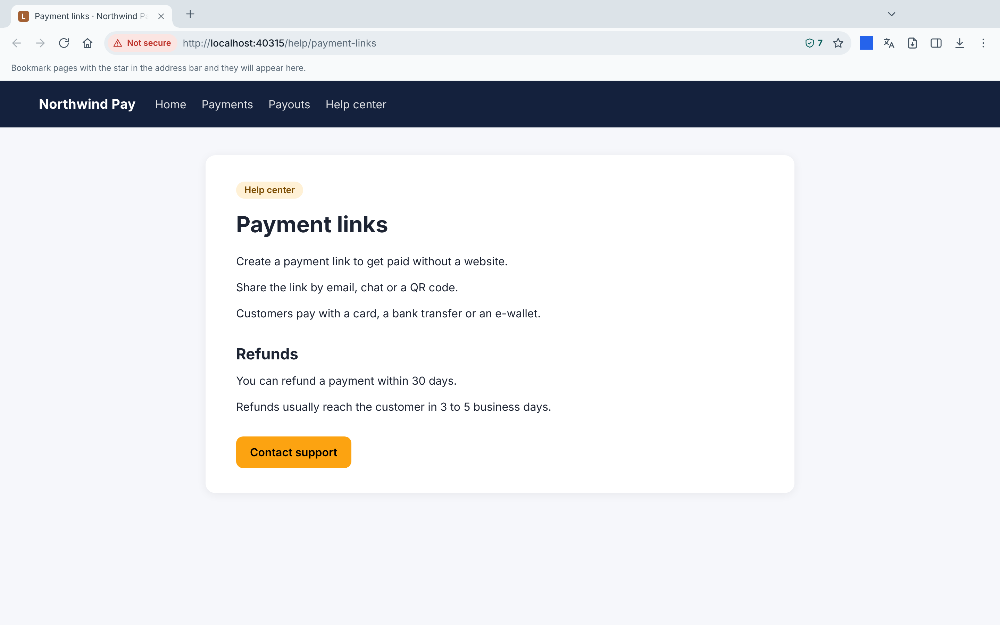
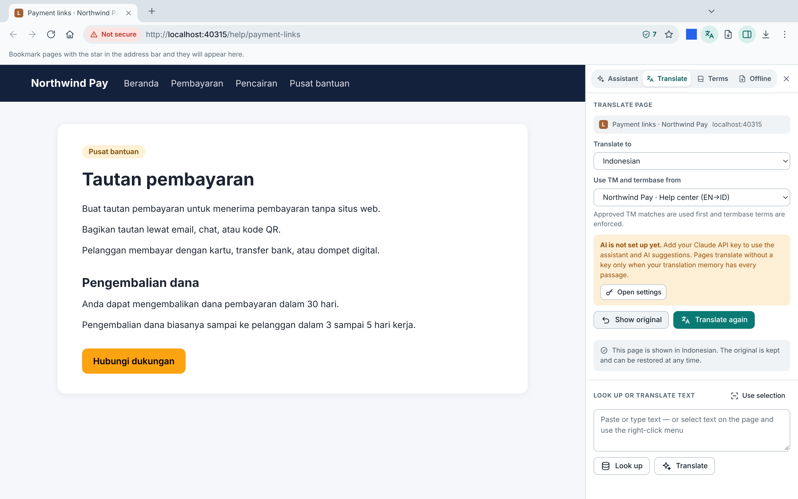
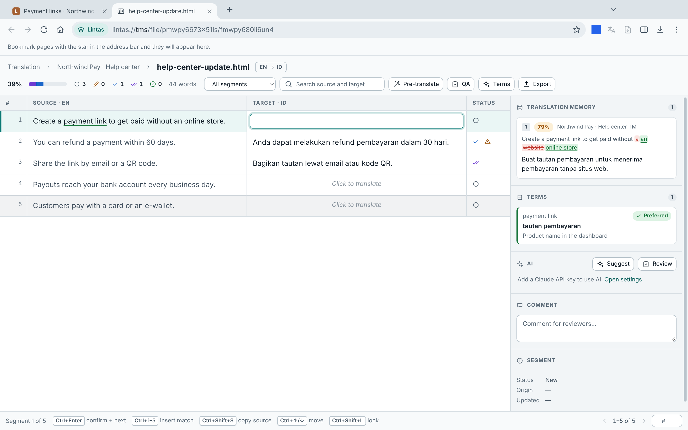
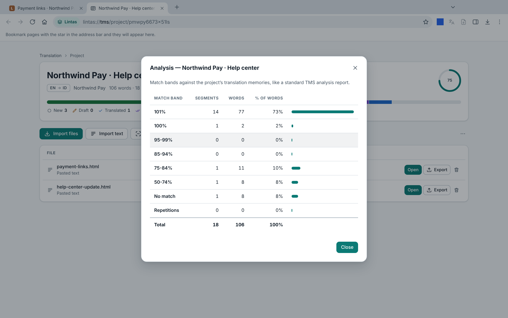
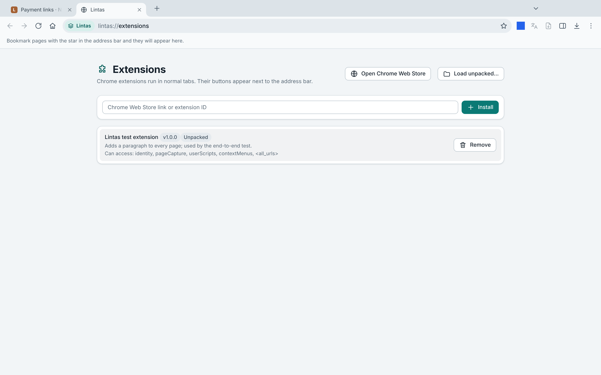
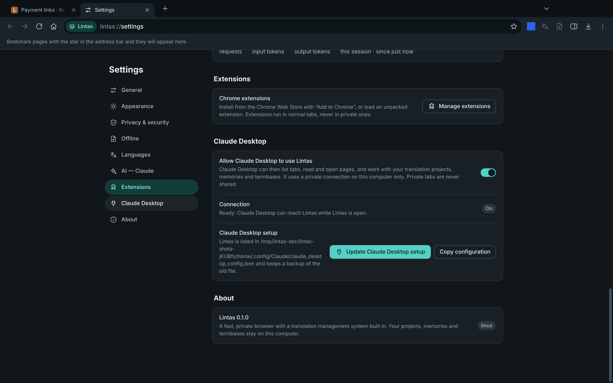
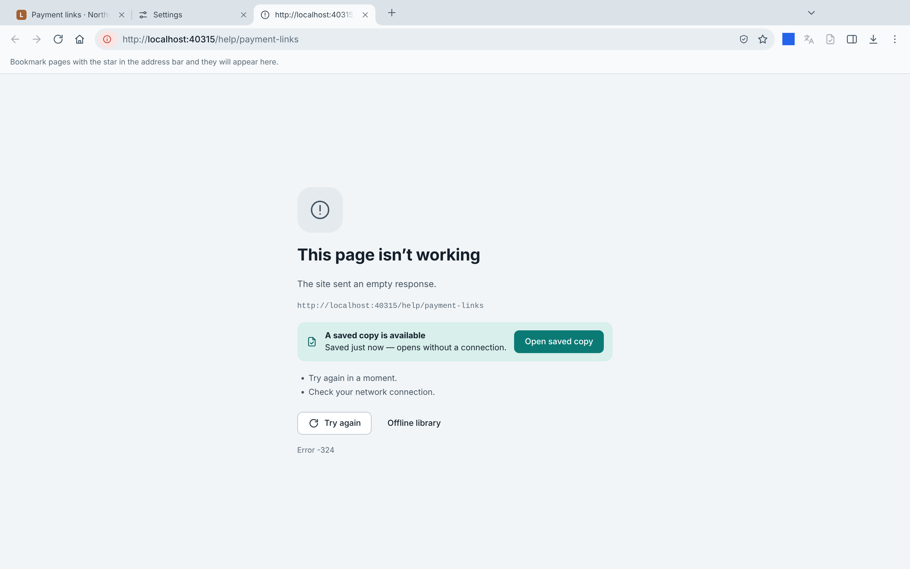

# Lintas

A fast, secure desktop web browser (Chromium engine) that works online and
offline, with a built-in **Translation Management System** and AI features
powered by Claude. Built for translators, localizers and linguists who also
write code.


## Download

Windows 10 and 11 (x64 and ARM64): get the installer or the portable version from
[GitHub Releases](https://github.com/ZenZeiTen/synthapps/releases?q=lintas). The release
page lists every file with its SHA-256 checksum. The builds are not code-signed yet, so
SmartScreen may ask you to confirm on first run (More info > Run anyway).

To make Lintas your default browser: Lintas Settings > General > Default browser. On Windows
this opens Settings > Default apps, where you pick Lintas for HTTP, HTTPS and .html; Windows
does not let apps change the default themselves.

## Features

**Browser**
- Chromium engine (Electron 45), every tab sandboxed, lazy session restore, private tabs.
- Tracker blocking, HTTPS-first with an optional HTTPS-only mode, third-party cookie
  stripping, Do Not Track and Global Privacy Control, per-site permission prompts.
- Google sign-in: Google refuses browsers built on Electron, so on `accounts.google.com`
  (and `accounts.youtube.com`) only, Lintas identifies itself as Firefox. Every other site
  sees the normal Chromium identity.
- Tab strip, omnibox with suggestions, bookmarks bar, side panel, find in page, zoom,
  downloads, history and the usual keyboard shortcuts.
- Import from Chrome, Edge, Firefox, Brave, Vivaldi, Opera or Chromium on the same
  computer (Settings → General → Import): bookmarks with their folders, up to 5,000 recent
  history entries, and the search engine and home page. Bookmarks you already have are
  skipped, so importing twice is safe. Any browser's bookmarks HTML export works too.
  The other browser's files are only read, from a temporary copy, so it can stay open.
  Passwords, cookies and open tabs are not imported.
- Optional *Minimize to the notification area* (menu bar on macOS, system tray on Linux):
  minimizing then takes Lintas off the taskbar, and its icon brings it back. Windows does
  not let apps pin themselves to the taskbar; right-click Lintas → *Pin to taskbar* once.

**Chrome extensions**
- Install from the Chrome Web Store: open chromewebstore.google.com in Lintas and choose
  *Add to Chrome*, or paste a store link on `lintas://extensions`. Installed extensions
  update automatically.
- Load unpacked extensions from a folder, for extension developers.
- Extension buttons and popups appear next to the address bar. Content scripts, background
  service workers, options pages and these `chrome.*` APIs work: `action`, `commands`,
  `contextMenus`, `cookies`, `notifications`, `runtime`, `storage`, `tabs`,
  `webNavigation`, `windows`, `webRequest`, `scripting`, `i18n`, `management` and
  devtools panels. This comes from Electron and
  [electron-chrome-extensions](https://github.com/samuelmaddock/electron-browser-shell).
- Lintas adds these on top, in extension pages and background workers, with the
  extension's manifest permissions checked on every call:
  `identity.launchWebAuthFlow` and `identity.getRedirectURL` (sign-in through a provider's
  web page), `tabs.captureVisibleTab`, `pageCapture.saveAsMHTML`, `userScripts`,
  `debugger`, `offscreen`, `alarms` and `sidePanel`. A side panel opens as a tab, because
  Lintas has no extension side panel. `tabGroups` and `declarativeNetRequest` exist only as
  stand-ins so extensions start: there are no tab groups, and network rules are not applied.
- Background workers only get these APIs when Lintas runs with Chromium's sandbox, which is
  the normal case. Started with `--no-sandbox` (needed as root), Electron skips the scripts
  that add them ([electron/electron#54322](https://github.com/electron/electron/issues/54322)),
  and `lintas://extensions` shows a warning.
- Extensions run in normal tabs, never in private ones.
- Not every Chrome extension works. Lintas is not Google Chrome, so extensions that need
  APIs Electron lacks fail or run in part. Examples: `identity.getAuthToken` (Google
  account sign-in), native messaging, `offscreen`, `declarativeNetRequest` rule sets, and Manifest V2 features
  Chrome itself has removed. Password managers that need native messaging also
  will not work.

**Smartling Context Capture**
- Tested with Smartling Context Capture 5.1.2 loaded in Lintas: it installs, its toolbar
  button opens the capture panel on the page, its background worker extracts the page, and
  the screenshot, MHTML capture and sign-in redirect APIs it calls all work.
- Not tested: signing in to Smartling and uploading a capture, because that needs a
  Smartling account. Sign-in uses `identity.launchWebAuthFlow`, which Lintas opens in a
  normal tab and closes when Smartling redirects back.
- The extension ID matches the Web Store one, so the sign-in redirect URL Smartling has
  registered is the same as in Chrome.

**Claude extension (Claude in Chrome)**
- Tested with version 1.0.107: it starts, and its toolbar button opens Claude's panel in a
  tab, showing its sign-in screen. Signing in and letting Claude act on pages have not been
  tested, because that needs a paid Claude account. Its links to the Claude desktop apps
  (native messaging) do not work.

**Claude Desktop (MCP)**
- Settings → Claude Desktop → *Allow Claude Desktop to use Lintas*, then *Add Lintas to
  Claude Desktop*. This adds a `lintas` entry to Claude Desktop's
  `claude_desktop_config.json`, keeps the other entries, and saves a backup of the old
  file. Restart Claude Desktop afterwards.
- Claude Desktop then has 18 tools:
  - browser: list tabs, open a URL, read a page as numbered paragraphs, get the
    selection, save a page offline, list the offline library
  - TMS: list, create and open projects; read and update segments; translation memory
    lookup; search and add terms; QA; import text; capture the open page
- How it connects: Claude Desktop starts `app/mcp/server.cjs` with the Lintas program
  itself (`ELECTRON_RUN_AS_NODE=1`, so no separate Node.js is needed). That script talks
  to the running browser over a Unix socket (macOS, Linux) or named pipe (Windows) that is
  readable only by you, with a random token. No network port is opened, and private tabs
  are never shared. Lintas must be open for the tools to work.
- If you move the Lintas app, press *Update Claude Desktop setup* again.
- Manual setup: *Copy configuration* gives the exact JSON to paste into the config
  file yourself.

**Offline**
- Save any page as one MHTML file. Ctrl/Cmd+S saves the current page.
- When a page fails to load, the error page offers the saved copy.
- Optional auto-save of every page you visit.
- The whole TMS works without a network.

**Translation Management System**
- Projects with a language pair. Import TXT, Markdown, HTML, DOCX, SRT, VTT, PO,
  XLIFF, JSON, CSV or TMX, or capture the open web page.
- Segment editor with statuses (new, draft, translated, reviewed, approved),
  locking, comments, filters and standard CAT shortcuts.
- Translation memory with fuzzy matching: 101 % (exact in context), 100 %, 99 %
  (case or punctuation only) and edit-distance scores, with word-level diffs. Every
  confirmed segment updates the TM. TMX import and export.
- Termbases with preferred, admitted and forbidden terms, recognised in every
  segment, including short inflected suffixes such as Indonesian *-nya*.
  TBX and CSV import, TBX export.
- QA checks:
  - numbers, locale-aware (1,000.50 = 1.000,50)
  - placeholders and tags
  - end punctuation and spacing
  - length ratio
  - missing and forbidden terms
  - inconsistent translations
- Match-band analysis report, pre-translation from the TM, and export back to the
  original format (PO, XLIFF, JSON, CSV, SRT/VTT, DOCX, HTML, TXT/MD) or to XLIFF,
  TMX, PO, JSON or CSV.

**AI (Claude, with your own API key)**
- Segment suggestions that use TM matches, the termbase and the neighbouring segments.
- MQM-style review and term extraction.
- Translate the open page in place: TM matches first, termbase enforced, one click
  to restore the original.
- Ask about the page and get answers with clickable paragraph citations.
- The key is stored encrypted with the operating system's keychain and is sent only
  to `api.anthropic.com`. Everything else in Lintas works without a key.

## Under the hood

These screenshots come from the real app, not the interface's preview mode, and show the
results of actual runs. `scripts/screenshots.mjs` regenerates them. The site in them is a
made-up help centre served on this computer.

**Tracker blocking.** The page loads seven tracking scripts and pixels (Google Analytics, Tag
Manager, Facebook, DoubleClick, Bing, Hotjar). Lintas blocks all seven before they leave the
computer. The shield shows the count, and the address bar marks the plain-HTTP site as not secure.



**Page translation from the translation memory, with no AI and no network.** The page's 14
text passages all have approved matches in the project's TM, so Lintas rewrites the page in
Indonesian on its own. No API key is set. The original stays in memory; *Show original* puts
it back.



**CAT editor.** For segment 1 the TM finds a 79 % fuzzy match and shows the word-level
difference ("a website" became "an online store"). The termbase underlines *payment link*,
a preferred term. Segment 2 carries a QA warning with two findings: the source says 60
days but the translation says 30, and *refund* was not translated as the required term
*pengembalian dana*.



**Analysis.** Match bands for the whole project, computed against its TM, the way a TMS
quote is prepared: 101 % (in-context) matches, 100 %, fuzzy bands, no match and repetitions.



**Chrome extensions.** An unpacked MV3 extension with background worker, content script and
toolbar button. It asks for `identity`, `pageCapture`, `userScripts` and `contextMenus`, the
APIs Lintas adds on top of Electron. This run had Chromium's sandbox on, so no warning shows.



**Claude Desktop over MCP.** Access is switched on, the local bridge is running, and Lintas
has written its entry into Claude Desktop's config file, keeping a backup of the old one.



**Offline fallback.** The page was saved as MHTML, then the site went down. The error page
offers the saved copy, which opens without a connection.



## Run from source

Requires Node.js 20 or later.

```bash
cd lintas
```

```bash
npm install
```

```bash
npm start
```

On first run, a sample English → Indonesian project is created so the TMS has
something to show. Add your Anthropic API key under Settings → AI to use the AI
features. The default model is Claude Opus 5.5; you can switch to Sonnet 5.5,
Haiku 5.5 or Fable 5.2 there.

Linux containers or CI running as root need `npm start -- --no-sandbox`, because
Chromium refuses to sandbox as root. Chrome extension background workers then miss the
APIs Lintas adds (see Chrome extensions above), so run as a normal user when you use
extensions.

## Build installers

```bash
npm run dist:linux
```

`dist:win` and `dist:mac` build the Windows (installer and portable) and macOS
(dmg and zip) versions on those systems. The `lintas` GitHub workflow builds all
three on every change and keeps them as downloadable artifacts. The builds are
not code-signed.

The Windows installer (`build/installer.nsh`) registers Lintas with Windows as a browser
(Default apps, "Open with" for web files) and removes that on uninstall. Links reach Lintas
as `Lintas.exe -- "<url>"`, so a link can never be read as a command-line switch; a second
launch hands its links to the running window.

## Releases

`lintas-release` (GitHub Actions) publishes a release when `version` in `package.json`
changes on `main` and no `lintas-v<version>` release exists yet. It runs the tests, builds
the Windows installer and portable version for x64 and ARM64, and creates the release with
`release-notes.md` and SHA-256 checksums. To ship a new version, raise `version` and merge.

## Tests

```bash
npm test
```

runs the unit tests for the text engine, parsers, TM, QA, TMS and security
rules.

```bash
xvfb-run -a node test/app.smoke.mjs
```

starts the real app and checks, end to end:
- browsing and tracker blocking
- history
- offline save and open, and the error page's saved-copy offer
- the TMS through the app's internal interface
- in-page translation and restoring the original page
- that AI features refuse to run without an API key
- a test Chrome extension: toolbar button, content script and background worker

`LINTAS_TEST_SANDBOX=1` runs it with Chromium's sandbox (as a non-root user) and also checks
the background worker's extra APIs: windows, contextMenus, identity, pageCapture, userScripts,
a screenshot and an MHTML capture.

The end-to-end test needs Playwright.

## Claude Desktop configuration (manual)

On macOS, with Lintas in /Applications, the entry looks like this. The button in
Settings writes the right paths for your computer.

```json
{
  "mcpServers": {
    "lintas": {
      "command": "/Applications/Lintas.app/Contents/MacOS/Lintas",
      "args": ["/Applications/Lintas.app/Contents/Resources/app.asar/app/mcp/server.cjs"],
      "env": { "ELECTRON_RUN_AS_NODE": "1", "LINTAS_DATA_DIR": "/Users/you/Library/Application Support/Lintas" }
    }
  }
}
```

## Layout

```
app/main/       Electron main process: tabs, security, offline library, Claude client
app/preload/    the only bridge to the interface (window.lintas)
app/mcp/        MCP server for Claude Desktop (stdio) and its tool definitions
app/renderer/   browser interface and TMS screens (vanilla JS, no network access)
core/           text engine, file formats, translation memory, QA and the TMS
docs/           IPC.md (interface contract), DESIGN.md, ANALYSIS.md (Opera Neon comparison)
```

## Known limits

- DOCX export keeps paragraphs but not run formatting (bold, styles).
- Third-party cookie blocking strips cookies on cross-site requests. It does not
  partition storage the way Chrome or Firefox do.
- There is no sync between devices.
- Chrome extensions: see the limits listed under Features.
