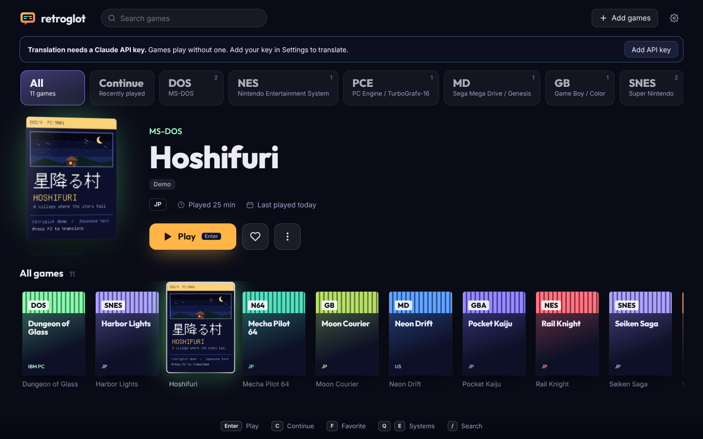
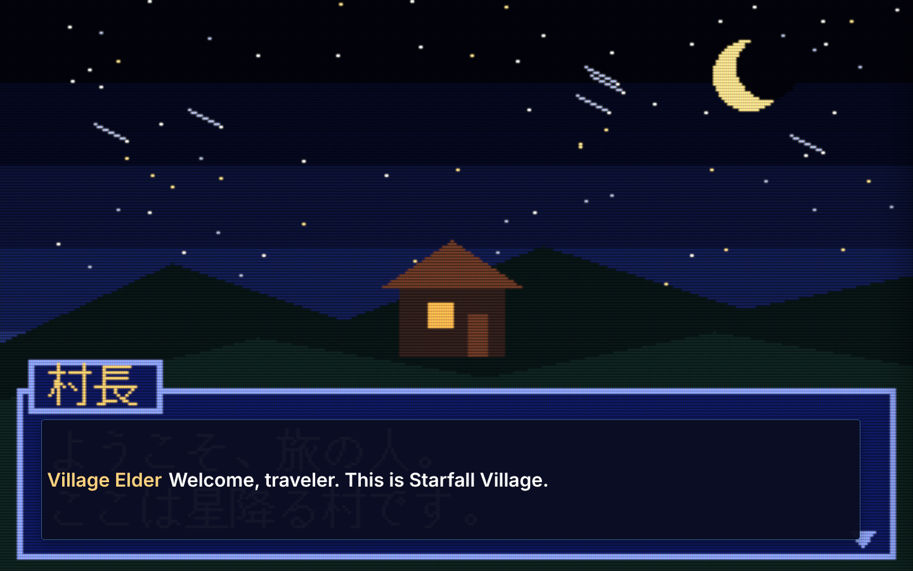

# retroglot

Play retro games from the DOS era to the PlayStation era in your browser, and read them in
your own language. retroglot is a game library and emulator front end with a live
translator built in: press **F2** and Claude reads the text on screen (Japanese dialogue,
menus, signs) and draws the translation right on top of it.





*The bundled demo game. The translation in this picture comes from the test stand-in for
Claude, so it shows the layout, not a live answer. The library picture uses made-up games.*

## What you get

- **A library that feels like a console.** Systems along the top, the chosen game large in
  the middle with its box art, a shelf of covers below. The light of the room changes with
  the system you browse. Drive it with mouse, keyboard or a game controller.
- **Real box art.** Covers, title screens and in-game pictures come from the libretro
  thumbnail collection (the same pictures RetroArch shows), matched by game name and kept
  on your computer. Games without one get a drawn cartridge label; you can also pick your own.
- **One library for every system.** Drop in ROMs, disc images and DOS games. Retroglot
  works out the system from the file name and its contents (cartridge headers, disc
  sectors, the files inside a zip), keeps play time, favourites and notes.
- **Full-window play.** The game fills the window, with a CRT screen look (or sharp pixels,
  smooth, or the xBR and ScaleFX upscalers that redraw pixel art with clean edges). The
  controls slide away while you play and come back when you move the mouse. Continue from
  your latest save straight from the library.
- **HD for 3D games.** Nintendo 64 games can render at up to 4× resolution with edge
  smoothing, texture upscaling (xBRZ or HQ4x), widescreen and, experimentally, fan-made HD
  texture packs. PlayStation games can switch to an HD renderer (Beetle PSX HW) with up to
  8× resolution and steady, wobble-free 3D (PGXP). See [Picture quality](#picture-quality).
- **Emulation in the browser.** Games run on [EmulatorJS](https://emulatorjs.org) with
  libretro cores: DOSBox Pure, FCEUmm, Snes9x, Mupen64Plus-Next, Gambatte, mGBA, Genesis
  Plus GX, PicoDrive, PCSX ReARMed and more. Gamepads work out of the box.
- **Translation over the picture.** Each piece of text becomes a box with its translation,
  sized to cover the original. Or show subtitles, or keep everything in the side panel.
  Hold **`** to peek at the original.
- **Auto-translate.** Turn it on and retroglot watches the screen. When new text appears and
  the screen settles, it is translated. A blinking cursor does not count as new text.
- **Consistent names.** Claude suggests a glossary entry the first time it meets a name or
  place, then uses it every time. You can edit the glossary; your entries always win.
- **The game's script.** Every line you translate is kept in order, with the speaker.
  Export it as text, CSV, or TMX for translation tools.
- **No paying twice.** A screen that was translated before is answered from memory.
- **Save states with pictures**, 8 slots per game, plus quick save and quick load.
- **Private by default.** The server listens on this computer only. Nothing leaves it
  except the screenshots you ask Claude to translate.


## Windows app

The easiest way on Windows: install **Retroglot** like any other program. No Node.js, no
terminal.

1. Download **Retroglot-Windows** from the latest successful
   [retroglot desktop build](https://github.com/ZenZeiTen/synthapps/actions/workflows/retroglot-desktop.yml)
   (open the newest green run, scroll to *Artifacts*). Unzip it. It holds two files:
   - `Retroglot-Setup-0.1.0.exe`: the installer (Start menu and desktop shortcuts).
   - `Retroglot-0.1.0-portable.exe`: runs without installing, for example from a USB stick.
2. Run it. The app is not code-signed yet, so Windows SmartScreen may say "Windows protected
   your PC". Click **More info**, then **Run anyway**.
3. On first start Retroglot downloads the emulator (about 70 MB, once). A progress bar shows
   how far it is.
4. For translation, click **Add API key** and paste your Claude API key from
   [console.anthropic.com](https://console.anthropic.com/settings/keys). Retroglot checks it
   and keeps it encrypted by Windows for your user account.
5. Click **Add the Japanese demo game**, open it, and press **F2**.

Your games, saves and translations are in `C:\Users\<you>\.retroglot` (menu *Retroglot >
Open data folder*); the downloaded emulator is in `%APPDATA%\Retroglot\runtime`.

To build the app yourself (on Windows, with Node.js 20 or newer), run `npm install`, then
`npm run dist:win`, in `retroglot/desktop`. The installer and the portable app appear in
`retroglot/desktop/dist`.

## Run from source (any system)

You need [Node.js](https://nodejs.org) 20 or newer and a recent Chrome, Edge or Firefox.

```bash
git clone https://github.com/ZenZeiTen/synthapps.git
```

```bash
cd synthapps/retroglot
```

```bash
npm install
```

```bash
npm start
```

Open **http://localhost:7777**. The library offers to download the emulator (EmulatorJS and
17 cores, about 70 MB, once); `npm run setup` does the same from the terminal. Add your
Claude API key under **Settings** (or start retroglot with `ANTHROPIC_API_KEY` set, or after
`ant auth login`). Games play without a key; only translation needs it. Then click **Add the
Japanese demo game**, open it, and press **F2**.

## Adding games

- Drag files onto the library window, or click **Add games**. Uploaded files are copied into
  the library folder.
- Or list a folder you already have: **Settings → Extra library folders** (one per line).
  Games there are listed where they are, not copied.
- Or from the command line: `node bin/retroglot.js add path/to/game.sfc`

retroglot ships no games and no BIOS files. Use games you own.

**Disc games** (PlayStation, Sega CD, PC Engine CD): a single `.chd` or `.pbp` file is
easiest. A `.cue` sheet works when its `.bin` files sit next to it. A zip of the cue and bins
also works.

**DOS games**: a `.zip` of the game folder is best; DOSBox Pure shows a menu to pick the
program to start. A single `.exe` or `.com` file works too.

**When the guess is wrong**: open the game's **⋮** menu in the library and pick the system.
The details show why retroglot guessed what it did.

**BIOS files** are optional for most systems (PCSX ReARMed has a built-in PlayStation BIOS).
Sega CD, Saturn and 3DO games need theirs, and so does the PlayStation HD renderer. Put the usual files, such as `scph5501.bin` or
`bios_CD_U.bin`, in the `bios` folder inside the data folder (`node bin/retroglot.js doctor`
shows where it is).

## Picture quality

Open the side panel (**F1**) and choose **Picture**.

- **Filter** applies to every game: CRT screen, sharp pixels, smooth (SABR), xBR or ScaleFX.
  xBR and ScaleFX suit 2D pixel art; they cost more graphics power than the others.
  Translation always reads the original picture, so the filter never changes the result.
- **Enhancements for this game** appear for Nintendo 64 and PlayStation games. Press
  **Apply and restart**: retroglot saves the moment, restarts the emulator with the new
  settings and continues from where you were.

| Nintendo 64 | What it does |
|---|---|
| Rendering resolution | Standard (640×480), 2×, 3× or 4×. 3× and 4× need a fast graphics card. |
| Edge smoothing | FXAA (light) or MSAA 4×. |
| Texture upscaling | xBRZ 4× or HQ4x for the game's own textures. |
| Widescreen | 16:9 view of the 3D world; menus and 2D pictures may look stretched. |
| HD texture pack (experimental) | Add a fan-made pack: a `.zip` of PNG files, or a `.hts`/`.htc` file. |

**HD texture packs.** A pack is made for one game and is matched by the game's internal name
(the panel shows it). Packs are loaded into the browser's memory, so they are limited to
1.5 GB; large packs also take a while to load at every start. retroglot places the files where
the N64 renderer (GLideN64) looks for them. It has not been tested with a real pack, so if a
pack seems to do nothing, check that it was made for GLideN64 (Rice-format PNG names) and for
the same game version.

| PlayStation | What it does |
|---|---|
| Renderer: HD (Beetle PSX HW) | Draws 3D at a higher resolution. Downloaded once (about 5 MB) the first time you choose it. |
| Rendering resolution | Native, 2×, 4× or 8×. |
| Steady 3D (PGXP) | Stops wobbling polygons and warping textures. |
| Widescreen | 16:9 view of the 3D world. |

The HD renderer needs the real PlayStation BIOS for the game's region in the `bios` folder:
`scph5500.bin` (Japan), `scph5501.bin` (USA) or `scph5502.bin` (Europe). Without it the game
keeps the standard renderer and the panel says which file is missing. Switching renderer
starts the game from the beginning, and each renderer keeps its own memory card saves.

## Systems

| System | Core | Installed by default |
|---|---|---|
| MS-DOS | DOSBox Pure | yes |
| NES / Famicom | FCEUmm | yes |
| Super Nintendo / Super Famicom | Snes9x | yes |
| Nintendo 64 | Mupen64Plus-Next | yes |
| Game Boy / Color | Gambatte | yes |
| Game Boy Advance | mGBA | yes |
| Virtual Boy | Beetle VB | yes |
| Master System | SMS Plus | yes |
| Mega Drive / Genesis, Game Gear, Sega CD | Genesis Plus GX | yes |
| 32X | PicoDrive | yes |
| PC Engine / TurboGrafx-16 (and CD) | Beetle PCE | yes |
| PlayStation | PCSX ReARMed | yes |
| Atari 2600, 7800, Lynx | Stella 2014, ProSystem, Handy | yes |
| Neo Geo Pocket, WonderSwan | Beetle NGP, Beetle WonderSwan | yes |
| Saturn, 3DO, Jaguar, Arcade (FinalBurn Neo), Amiga, C64 | Yabause, Opera, Virtual Jaguar, FBNeo, PUAE, VICE | with `--all` or `--cores` |

Install more cores: `node bin/retroglot.js install-runtime --cores fbneo,yabause`, or
`--all` for every one. `node bin/retroglot.js systems` shows what is installed.

## Translating

| Key | What it does |
|---|---|
| **F2** | Translate the screen now (Shift-click the button to skip the memory and ask again) |
| **F3** | Auto-translate on or off |
| **F4** | Boxes → subtitles → side panel only |
| hold **`** | Hide translations to see the original |
| **F6** / **F7** | Quick save / quick load (slot 1) |
| **F9** | Pause or resume |
| **F1** | Script, glossary, saves and game notes |

In the library: arrow keys (or the controller's d-pad) move between games, **Enter** (A)
plays, **C** (X) continues from the latest save, **F** (Y) marks a favourite, **Q** and **E**
(the shoulder buttons) switch systems, **/** searches.

Game controls and gamepads are set in the emulator's own menu (the gear at the bottom of the
game picture). retroglot's keys were chosen so they do not clash with the default controls.

**Settings** (gear in the library): the language to translate into, the style (natural,
literal for learners, or localized), the Claude model, how hard Claude thinks, how
translations are shown, and how small a screen change starts an auto-translation.

**Help Claude with the game.** In the player, the **Game** tab has the game's language and
notes: who the characters are, the tone you want, terms to keep. They go with every request.

### Cost

Each new screen is one request to Claude with one screenshot. Screens seen before cost
nothing. The player shows a running estimate for each game. As a rough guide, a screen with
Claude Opus 5.5 at low effort uses a couple of thousand input tokens and a few hundred
output tokens, about one to two US cents; Claude Haiku 5.5 is far cheaper. These figures are
estimates from the prices and request size, not measured bills; check your usage in the
Claude Console. Auto-translate in a busy game sends more requests than pressing F2 yourself.

## Command line

```
node bin/retroglot.js start [--port 7777] [--home DIR] [--library DIR]...
node bin/retroglot.js install-runtime [--all] [--cores a,b] [--force]
node bin/retroglot.js add FILE...
node bin/retroglot.js scan
node bin/retroglot.js doctor
node bin/retroglot.js systems
```

Everything retroglot keeps (library, save states, covers, translations, settings) is in one
data folder: `~/.retroglot`, or the folder in `RETROGLOT_HOME` or `--home`. Back up that
folder to back up everything.

## Troubleshooting

- **"The emulator runtime is not installed"**: click **Install emulator** in the library (or
  run `npm run setup`). If the download fails, check the internet connection or proxy.
- **"The ... core is not installed"**: run the `install-runtime --cores` command the message
  shows.
- **A DOS game shows `Illegal command`**: the program name is too long for DOS. retroglot
  renames single `.exe` and `.com` files for you; for other cases, zip the game folder.
- **Translation says the credentials were rejected**: open **Settings**, paste the key again
  and click **Save key**; retroglot tells you whether Claude accepts it.
- **Windows says "Windows protected your PC"**: the app is not code-signed. Click **More
  info**, then **Run anyway**. Signing needs a code-signing certificate.
- **Keys go to the game instead of retroglot, or the other way round**: click the game
  picture once so it has the keyboard. retroglot's keys (F2 and so on) work either way.
- **An HD setting makes the game slow**: lower the rendering resolution, or turn MSAA off.
  The game runs on your graphics card through the browser, which costs more than a native
  emulator.
- **The PlayStation HD renderer does not start**: check the panel's message about the BIOS;
  Beetle PSX accepts only the files named above (`scph1001.bin` does not work for it).
- **The page cannot be opened from another computer**: on purpose. retroglot answers only on
  this computer. `--host 0.0.0.0 --allow-host NAME` opens it up, but then anyone who can
  reach it can use your Claude key.

## Licences and legal notes

retroglot's own code is MIT licensed. EmulatorJS (GPL-3.0) and the emulator cores are not
part of this repository: `npm run setup` downloads them from the npm registry. Each core has
its own licence; some (Snes9x, Genesis Plus GX, PicoDrive and the MAME-derived cores) do
not allow commercial use. Check the licences before you offer retroglot as a paid product
or bundle it with the runtime.

The demo game *Hoshifuri* is original content made for retroglot. Its text is drawn with GNU
Unifont (SIL Open Font Licence 1.1). `demo/build_demo.py` rebuilds it.

Translating a game for your own play is up to you and the law where you live; sharing
exported scripts of commercial games may need the rights holder's permission.

## What has been tested

- 42 unit tests (box art matching was checked by hand against the libretro collection):
  system detection, the library, save states, translation memory, script export, the Claude
  request (checked against a stand-in API), server safety checks, the emulator download
  (checksums, unsafe paths), the saved API key, and the picture enhancements (core options,
  texture pack placement, PlayStation BIOS choice, shader conversion).
- 10 browser tests in headless Chromium: the demo boots in DOSBox Pure, a test NES cartridge
  boots on FCEUmm, F2 draws the translation over the dialogue window, the same screen is
  answered from memory, the glossary picks up new names, auto-translate follows the dialogue
  to the next screen, save then load returns to the same picture, and the xBR and ScaleFX
  filters compile and leave translation screenshots unchanged.
- Picture enhancements, checked by hand with N64 homebrew test programs in headless
  Chromium: 2× and 3× resolution (the core reported 1280×960 and 2560×1440 in widescreen),
  FXAA, xBRZ, widescreen, **Apply and restart** continuing from the same moment, and a small
  texture pack unpacked into the folder GLideN64 reads. xBR and ScaleFX were checked in both
  WebGL 1 (DOS) and WebGL 2 (N64).
- Not tested: whether a real HD texture pack replaces textures in a real game, and the
  PlayStation HD renderer booting a game (that needs a real BIOS and disc; only the core
  switch, its download and the BIOS choice were checked).
- The desktop app runs a self-test (`npm run smoke` in `desktop/`): first start, emulator
  download inside the app, the demo booting in DOSBox Pure, and the missing-key message. It
  passed on Linux; the Windows build runs the same test on a Windows machine in CI.
- Not tested yet: a live Claude API key (all translation tests use the stand-in), and real
  games on the other cores. They run on the same EmulatorJS path as DOS and NES, but each
  core has its own quirks.

```bash
npm test
```

```bash
npm run test:e2e
```
